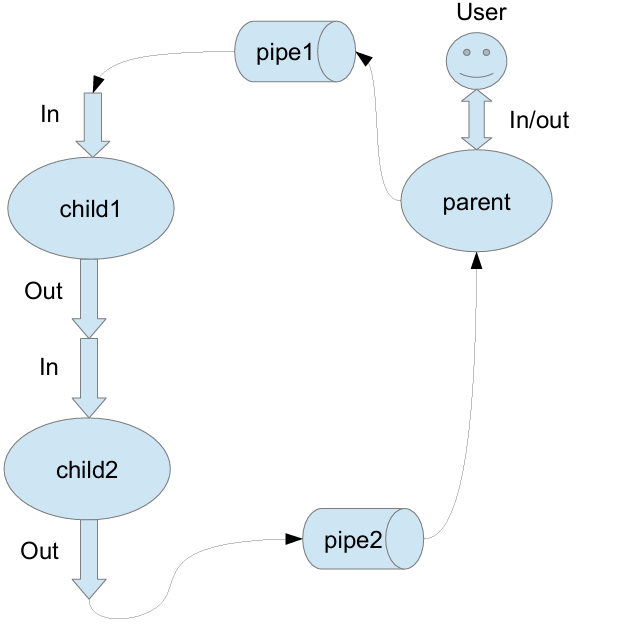

# Лабораторная работа №3
Составить и отладить программу на языке Си, осуществляющую работу с процессами и 
взаимодействие между ними в одной из двух операционных систем. В результате работы 
программа (основной процесс) должен создать для решение задачи один или несколько дочерних 
процессов. Взаимодействие между процессами осуществляется через системные сигналы/события 
и/или через отображаемые файлы (memory-mapped files). 
Необходимо обрабатывать системные ошибки, которые могут возникнуть в результате работы. 

## Вариант 11


Родительский процесс создает два дочерних процесса. Перенаправление стандартных потоков 
ввода-вывода показано на картинке выше. Child1 и Child2 можно «соединить» между собой 
дополнительным каналом. Родительский и дочерний процесс должны быть представлены 
разными программами. 
Родительский процесс принимает от пользователя строки произвольной длины и пересылает их в 
pipe1. Процесс child1 и child2 производят работу над строками. Child2 пересылает результат своей 
работы родительскому процессу. Родительский процесс полученный результат выводит в 
стандартный поток вывода.
Child1 переводит строки в верхний регистр. Child2 превращает все пробельные 
символы в символ «_».

## Требования
- Компилятор gcc
- Утилита make

## Сборка и запуск

Из корневой директории проекта:

```bash
make && ./parent
```